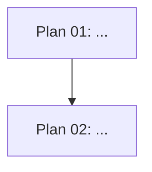

# Program Control Plane

## Contents

- Purpose
- Feature `README.md` template
- Multi-agent coordination rules

## Purpose

Use the feature `README.md` as the control plane for a main agent or multi-agent execution. Summarize the complete program without duplicating plan detail.

## Feature `README.md` Template

````md
# {Feature Name} Implementation Program

## Goal

{One paragraph.}

## Planning controls

- Operating mode: `review | implement`
- Target level: `1 | 2 | 3 | 4 | 5`
- Shared-level assumption: {All routed stacks use the same target level unless listed below.}
- Stack-level overrides: `none` or list
- Assessed current level by stack:
  - API:
  - Android:
  - Next.js:
  - Security:
  - Documentation:

## Planning state

- Overall status: `not-started | in-progress | blocked | complete`
- Last updated: `{date or commit}`
- Source goal: {user request, issue, ticket, or document}
- Planning directory: `docs/plans/{feature-slug}/`

## Read this first

1. [`CURRENT-STATE.md`](./CURRENT-STATE.md) — repository facts, current levels, and relevant execution paths.
2. [`REQUIREMENTS.md`](./REQUIREMENTS.md) — required behavior, target-level gates, and acceptance scenarios.
3. The next unblocked plan in the execution order below.

## Plan index

| Order | Plan | Outcome | Target level | Status | Depends on | Parallel group |
| ----: | ---- | ------- | ------------ | ------ | ---------- | -------------- |
| 1 | [`PLAN-01-...`](...) | ... | L3 | not-started | none | A |
| 2 | [`PLAN-02-...`](...) | ... | L3 | not-started | Plan 01 | B |

Use the same order number for plans that may execute in parallel.

## Dependency graph



If Mermaid is not used in the repository, provide a text graph.

## Recommended execution order

### Stage 1 — {Foundation}

- Plan 01
- Exit criteria: ...

### Stage 2 — {Parallel capabilities}

- Plan 02
- Coordination point: ...

### Stage 3 — {Integration and rollout}

- Plan ...
- Exit criteria:
  - Level-specific verification passes.
  - Documentation reflects implemented level.
  - Deferred higher-level capabilities are recorded.

## Global TODO

Use this only for cross-plan tracking. Detailed tasks stay inside plan files.

- [ ] All blocking unknowns are resolved.
- [ ] Target level is consistent across workstreams or overrides are documented.
- [ ] Plan 01 complete.
- [ ] Cross-plan integration tests pass.
- [ ] Target-level security and observability checks pass.
- [ ] Documentation updated.
- [ ] Final acceptance scenarios pass.

## Multi-agent assignment guide

| Work package | Recommended capability | Allowed scope | Inputs | Required output |
| ------------ | ---------------------- | ------------- | ------ | --------------- |
| Plan 01 | data/backend/etc. | exact directories | plan files | code/review notes, tests, completion evidence |

## Cross-plan contracts

| Contract | Owner | Consumers | Compatibility rule | Target level |
| -------- | ----- | --------- | ------------------ | ------------ |
| ... | Plan 01 | Plans 02, 03 | ... | L3 |

## Critical path

`Plan 01 -> Plan 02 -> Plan 04`

Explain why these plans determine the earliest completion date.

## Deferred higher-level capabilities

| Capability | Required at | Deferred because | Follow-up owner |
| ---------- | ----------- | ---------------- | --------------- |
| ... | L4/L5 | Target is L3 | ... |

## Decision summary

- ...
- See [`DECISIONS.md`](./DECISIONS.md) or repository ADRs.

## Blockers and unresolved questions

| ID | Blocker | Affects | Level impact | Owner | Resolution |
| -- | ------- | ------- | ------------ | ----- | ---------- |
| ... | ... | ... | ... | ... | ... |

## Definition of done

The feature or review program is complete only when:

- all required plan tasks are checked;
- all acceptance scenarios pass or all review findings are reported;
- required CI checks pass for the target level;
- migrations and rollback are validated when required by level;
- security and observability requirements are satisfied for the target level;
- documentation reflects final behavior and target level;
- deviations are captured;
- no blocking question remains.
````

## Multi-Agent Coordination Rules

- Use multi-agent assignments only when authorized and useful.
- Assign one owner per task at a time.
- Require agents to read `CURRENT-STATE.md`, `REQUIREMENTS.md`, the feature `README.md`, and their assigned plan.
- Give every assignment an exact allowed scope, inputs, required outputs, target level, and verification obligations.
- Let agents inspect additional files when needed, but require planning updates when discoveries invalidate the plan or target-level assumptions.
- Do not silently change another plan's contract or level.
- Record an explicit coordination note for shared interfaces.
- Require evidence before marking work complete.
