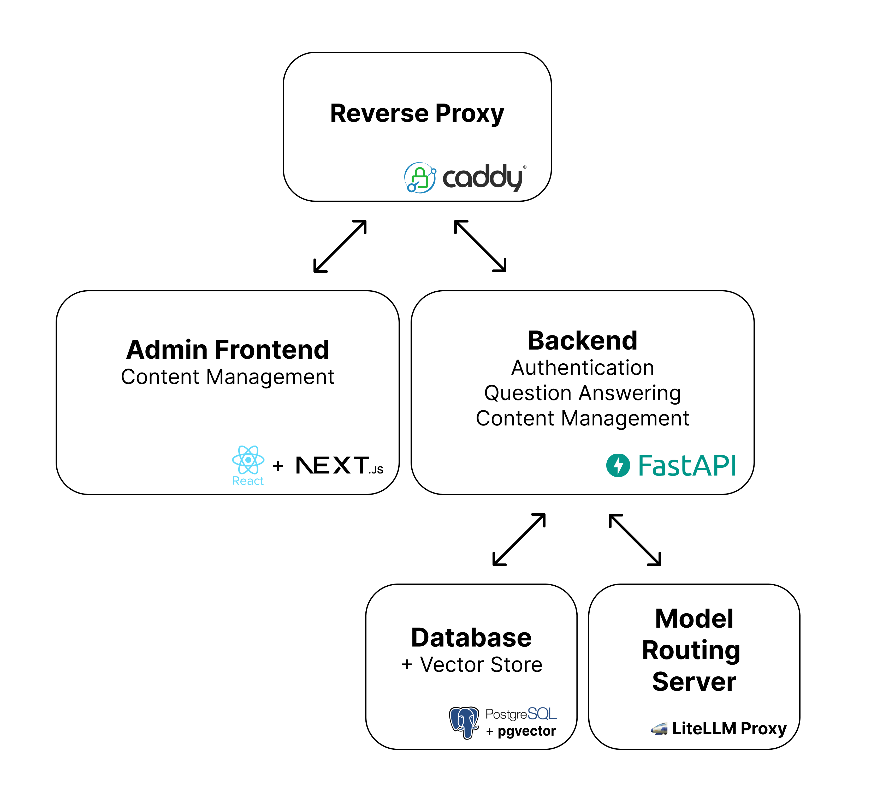

<p align="center">


</p>

<p align="center" style="text-align:center">
<a href="https://docs.ask-a-question.com/">Developer Docs</a> |
<a href="#features">Features</a> |
<a href="#getting-started">Getting started</a> |
<a href="#usage">Usage</a> |
<a href="#architecture">Architecture</a> |
<a href="#funders-and-partners">Funders and Partners</a>
</p>

**[Ask A Question](https://ask-a-question.com/)** is a free and open-source tool created to help non-profit organizations, governments in developing nations, and social sector organizations use **Large Language Models** for responding to citizen inquiries in their **native languages**.

## :woman_cartwheeling: Features

#### **:question: LLM-powered search**

Match your questions to content in the database using embeddings from LLMs.

#### **:robot: LLM responses**

Craft a custom reponse to the question using LLM chat and the content in your database

#### **:electric_plug: Integrate with your own chatbot**

Connect to your own chatbot on platforms like [Turn.io](https://www.turn.io/), [Glific](https://glific.org/), and [Typebot](https://typebot.io/) using our APIs.

#### **:books: Manage content**

Use the AAQ App to add, edit, and delete content in the database (Sign up for a demo [here](https://app.ask-a-question.com))

#### :rotating_light: Message Triaging

Identify urgent or important messages based on your own criteria.

#### :office_worker: Content manager dashboard

See which content is the most sought after, the kinds of questions that receive poor feedback, identify missing content, and more

## :construction: Upcoming

#### **:speech_balloon: Conversation capability**

Refine or clarify your question through conversation

#### :video_camera: Multimedia content

Respond with not just text but voice, images, and videos as well.

#### :technologist: Engineering dashboard

Monitor uptime, response rates, throughput HTTP reponse codes and more

> [!NOTE]
> Looking for other features? Please raise an issue with `[FEATURE REQUEST]` before the title.

## Getting started

The repo holds three apps: `core_backend` (FastAPI), `admin_app` (Next.js) and
`docs-site` (MkDocs). They depend on PostgreSQL with pgvector, Redis and a
LiteLLM proxy. You can run everything in Docker, or run the apps on your machine
with only those dependencies in Docker.

Run `make` at the repo root to see every available target.

### 1. Configure (both options)

```shell
make docker-env
```

This copies the templates in `deployment/docker-compose/` to `.base.env`,
`.core_backend.env` and `.litellm_proxy.env`, and creates an empty
`.gcp_credentials.json`. Existing files are never overwritten. Then:

- Add at least one LLM provider key (e.g. `OPENAI_API_KEY`) to
  `deployment/docker-compose/.litellm_proxy.env`. The models in use are set in
  `deployment/docker-compose/litellm_proxy_config.yaml`.
- Replace `.gcp_credentials.json` with a real service-account file only if you
  use Vertex AI or Google Cloud Storage.
- Before deploying anywhere, change the secrets in `.core_backend.env`
  (`JWT_SECRET`, `ADMIN_PASSWORD`, `ADMIN_API_KEY`, `POSTGRES_PASSWORD`).
  `make docker-env` warns you about any that still have their template value.

### 2a. Run everything in Docker

Prerequisite: Docker with Compose v2.

```shell
make dev
```

This builds and starts every service from `docker-compose-dev.yml` with live
reload. Source folders are mounted into the containers, so edits on your machine
show up straight away.

| Service   | URL                                                  |
| --------- | ---------------------------------------------------- |
| Admin app | <http://localhost:3000>                              |
| Backend   | <http://localhost:8000> (API docs at `/docs`)        |
| Docs site | <http://localhost:8001>                              |
| Postgres  | `localhost:5434` · Redis `localhost:6380` · LiteLLM `localhost:4001` |

The first start takes a few minutes while images build and dependencies install.

| Command                          | What it does                                              |
| -------------------------------- | --------------------------------------------------------- |
| `make dev-logs [SERVICE=…]`      | Follow logs, optionally for one service                   |
| `make dev-ps`                    | Show container status                                     |
| `make dev-shell [SERVICE=…]`     | Open a shell in a container (defaults to `core_backend`)  |
| `make dev-migrate`               | Run Alembic migrations in the backend container           |
| `make dev-rebuild`               | Rebuild images after `uv.lock` or `pnpm-lock.yaml` changes |
| `make dev-down`                  | Stop the stack, keeping the database                      |
| `make dev-clean`                 | Stop the stack and delete its volumes (wipes the dev DB)  |

Optional services are enabled with `PROFILES`, for example
`make dev PROFILES="speech huggingface-embeddings"`. To have the backend use the
speech service, set `CUSTOM_STT_ENDPOINT` and `CUSTOM_TTS_ENDPOINT` in
`.core_backend.env` (examples are in the template).

**Production-style stack.** `make prod-up` runs the optimised images behind Caddy
with automatic HTTPS on `https://$DOMAIN` (`localhost` by default). It includes a
Postgres container by default (`PROD_PROFILES=local-db`). For that to work, set
`POSTGRES_HOST=relational_db` in `.core_backend.env`. To use a managed database
instead, run `make prod-up PROD_PROFILES=` and point `POSTGRES_HOST` at it. Use
`make prod-logs`, `make prod-ps` and `make prod-down` to manage it.

### 2b. Run the apps locally

Prerequisites: Docker, [uv](https://docs.astral.sh/uv/), and Node.js LTS with
[corepack](https://nodejs.org/api/corepack.html). Corepack provides the pnpm
version pinned in `admin_app/package.json`.

**Dependencies.** Start Postgres (`:5432`), Redis (`:6379`) and LiteLLM
(`:4000`) as standalone containers. This also runs the database migrations:

```shell
make setup-dev
```

Remove the containers with `make teardown-dev` when you're done. If you'd rather
not run LiteLLM in Docker, `make setup-llm-proxy-local` runs it as a local
process on port 4001 instead.

**Backend** (<http://localhost:8000>):

```shell
cd core_backend
cp .env.example .env    # defaults already point at the containers above
uv sync
uv run --env-file .env python -m app.main
```

The backend doesn't load `.env` on its own, so keep the `--env-file` flag. The
Postgres credentials in `core_backend/.env` must match those in
`deployment/docker-compose/.core_backend.env`, because the database container was
created from that file. If you use `setup-llm-proxy-local`, set
`LITELLM_ENDPOINT=http://localhost:4001` in `core_backend/.env`.

**Admin app** (<http://localhost:3000>), in a new terminal:

```shell
cd admin_app
corepack enable
pnpm install
pnpm dev
```

The admin app reaches the backend through its `/bff` routes. They use
`BACKEND_INTERNAL_URL`, which defaults to `http://localhost:8000`.

**Docs site** (optional, <http://localhost:8001>):

```shell
cd docs-site
uv run mkdocs serve --dev-addr 127.0.0.1:8001   # 8000 is taken by the backend
```

**Tests and linting** run per app. Use `uv run pytest` or `make -C core_backend lint`
for the backend, and `pnpm test` or `pnpm lint` for the admin app. The backend
tests start their own throwaway Postgres and Redis containers.

See the [developer docs](https://docs.ask-a-question.com/) for more detail.

## Usage

To get answers from your database of contents, you can use the `/search` endpoint. This endpoint returns the following:

- Search results: Finds the most similar content in the database using cosine distance between embeddings.
- (Optionally) LLM generated response: Crafts a custom response using LLM chat using the most similar content.

See [docs](https://docs.ask-a-question.com/) or [API docs](https://app.ask-a-question.com/api/docs) for more details and other API endpoints.

### :question: Simple content search

```shell
curl -X 'POST' \
  'https://[DOMAIN]/api/search' \
  -H 'accept: application/json' \
  -H 'Authorization: Bearer <BEARER TOKEN>' \
  -H 'Content-Type: application/json' \
  -d '{
  "query_text": "how are you?",
  "generate_llm_response": false,
  "query_metadata": {}
}'
```

### :robot: With LLM response

The query looks the same as above, except `generate_llm_response` is set to `true`:

```shell
curl -X 'POST' \
  'https://[DOMAIN]/api/search' \
  -H 'accept: application/json' \
  -H 'Authorization: Bearer <BEARER TOKEN>' \
  -H 'Content-Type: application/json' \
  -d '{
  "query_text": "this is my question",
  "generate_llm_response": true,
  "query_metadata": {}
}'
```

### :books: Manage content

You can access the admin console at

```
https://[DOMAIN]/
```

## Architecture

We use docker-compose to orchestrate containers with a reverse proxy that manages all incoming traffic to the service. The database and LiteLLM proxy are only accessed by the core app.

<p align="center">
  
</p>

## Documentation

See [here](https://docs.ask-a-question.com/) for full documentation.

## Funders and Partners


